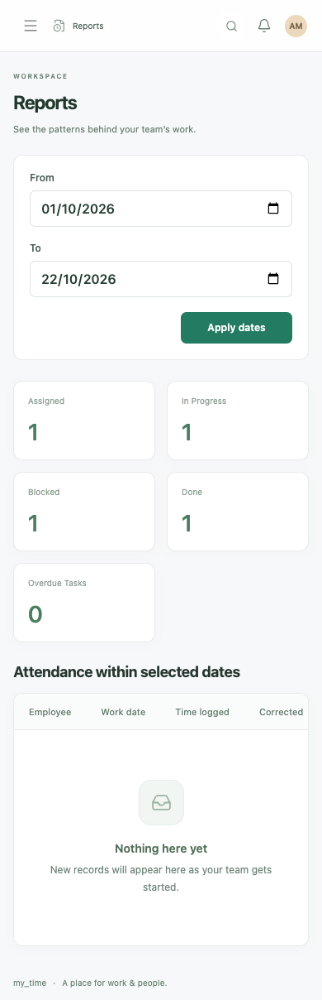
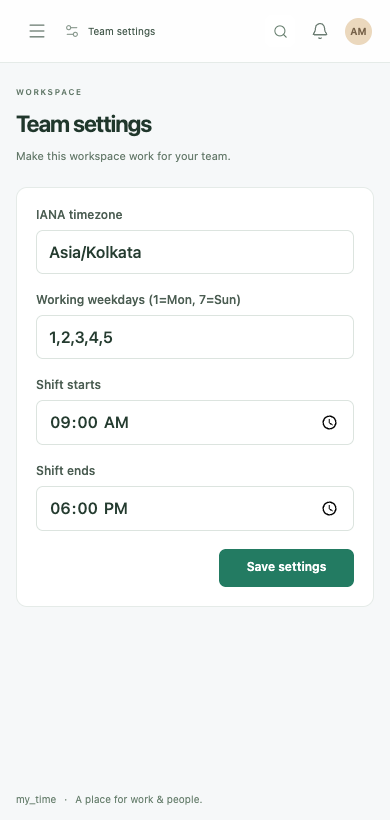
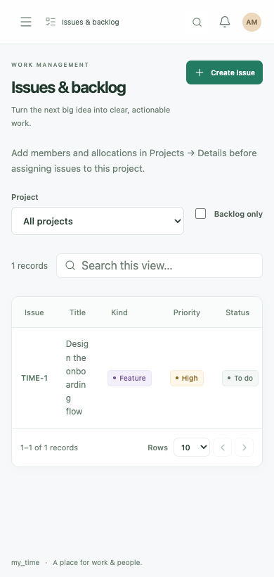

# Responsive workspace coverage

Every workspace view shares responsive layout rules in `src/style.css`. Coverage includes the task board, projects, issue/backlog views, sprints, employees and profiles, attendance and corrections, calendars, leave and balances, holidays and policies, locations, notifications, reports, audit history, settings, team administration, sign-in, and mandatory password changes.

## Layout behavior

- Small screens use mobile navigation, wrapping headings/toolbars, and one-column forms and project cards.
- Dashboard summaries adapt to the available width; reports retain readable summary cards.
- Wide tables and board columns scroll inside their containers, keeping the document itself within the viewport. Full data remains available rather than hiding columns.
- Long record titles wrap. Project detail tabs scroll within the dialog when necessary.
- Creation and detail dialogs stay inside the viewport. Long forms scroll, while creation actions remain available in a separate footer. Short landscape screens have reduced dialog padding.
- Phone form fields use larger text and controls. Touch input has larger action targets; safe-area padding protects bottom controls.
- Table pagination wraps on very narrow screens, and forms preserve entered values when validation fails.

## Browser checks

Run `npm run test:e2e`. The suite contains eight workflow checks plus nine responsive scenarios and uses isolated mock API data rather than the real database.

| Scenario | Chrome viewport |
|---|---|
| All 18 lead views, creation dialogs, and key record details | 320 × 820, 390 × 820, 768 × 820, 1024 × 820 |
| Member leave and correction forms | 320 × 640 |
| Team administration and lead creation | 320 × 640 |
| Issue creation with visible submit controls | 740 × 360 landscape |
| Mandatory password change | 320 × 640 |
| All lead views with mobile/touch emulation | 390 × 844 |
| Existing desktop workflow checks | 1440 × 1000 |

Checks assert document overflow, dialog bounds, field widths, creation/detail accessibility, and runtime errors across the page set. Actual Safari/Firefox and real-device testing remain separate from these Chrome checks.

All 17 browser checks and the production build pass.

## Reviewed phone layouts

