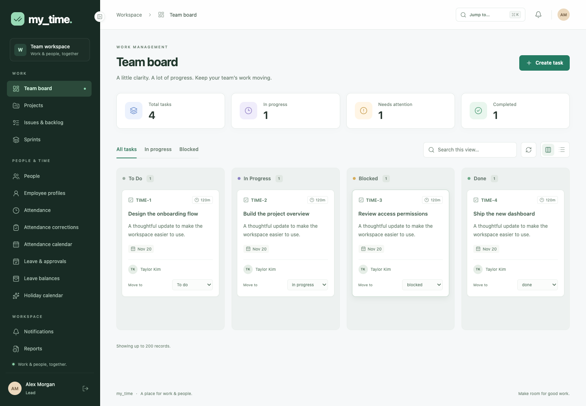
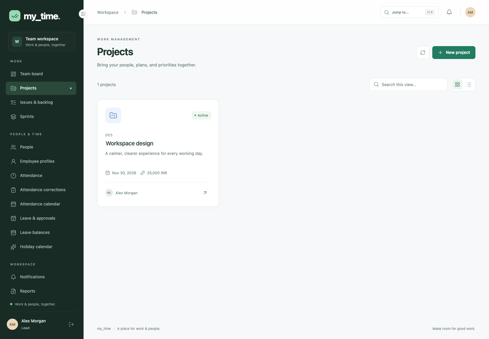
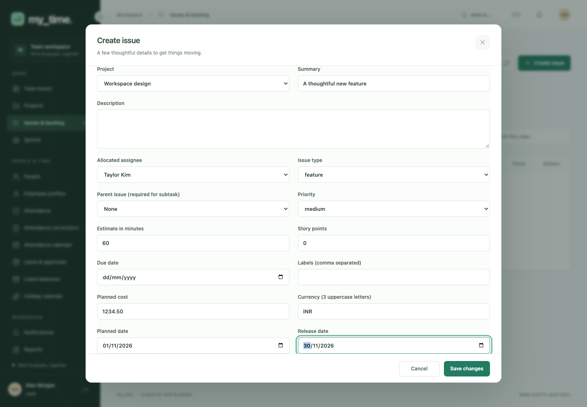
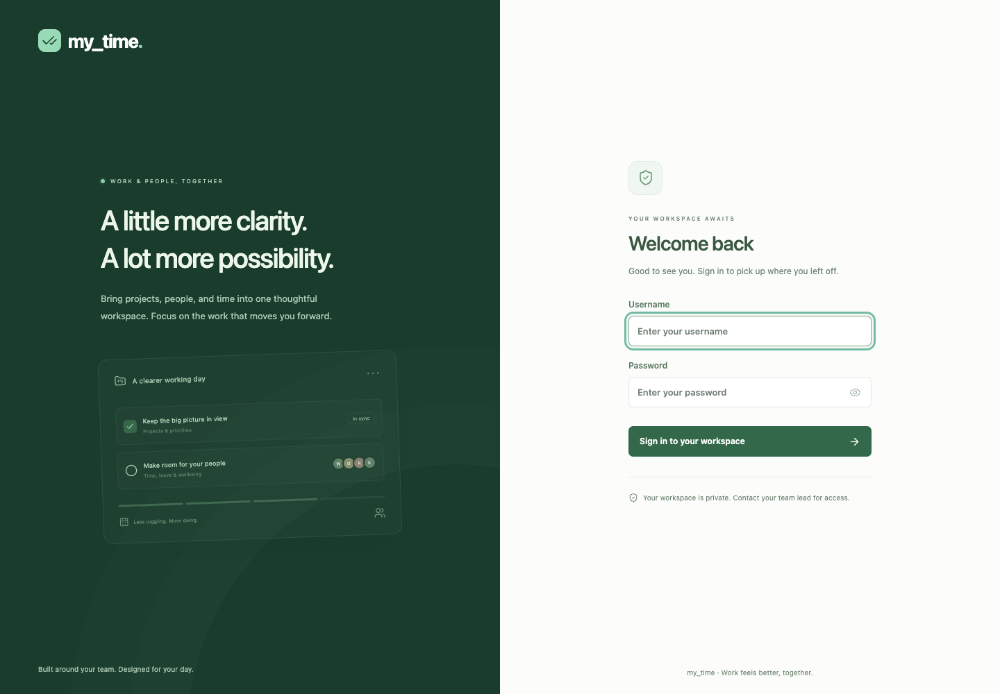
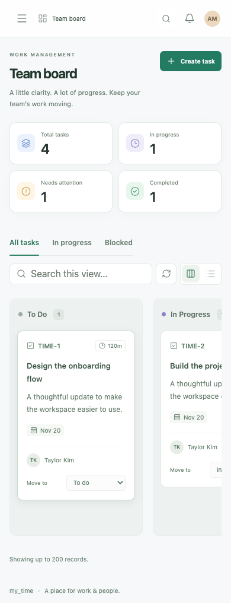

# Interface preview

The refreshed interface uses an ink-green sidebar, restrained teal accents, consistent spacing, readable text, and reusable controls. Screenshots below were captured in Chrome using isolated test fixture data. The running application continues to fetch actual backend data.

## Team board

Status summaries, filter tabs, search, board/list modes and contextual task actions.

## Projects

Project cards show ownership, planning and cost information. Open a project for Planning & details and Members & allocation tabs.

## Issue creation

A keyboard-accessible Radix dialog keeps project, feature, allocation, cost and date fields together. Validation errors preserve the draft.

## Sign-in

## Mobile

Compact summaries, searchable views, a scrollable board and a mobile navigation drawer.

## Verification

`npm run build` passes the TypeScript check and production build. All 17 `npm run test:e2e` Chrome tests pass against a mocked API. Tests cover create/edit workflows, allocation payloads, feature planning metadata, modal focus restoration, keyboard navigation, mobile overflow, sorting/pagination, validation, session expiry and password visibility. The suite also covers every page at phone/tablet widths, admin/member forms, touch emulation and landscape dialogs. They do not replace live backend integration tests or a full accessibility audit.
